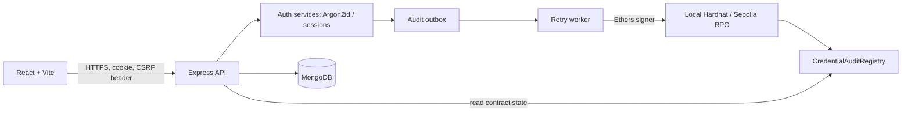

# Blockchain-Based Password Security System

A hybrid authentication application: the backend remains the authentication authority, MongoDB stores private account/session data, and an EVM smart contract anchors opaque credential-version commitments for tamper-evident lifecycle auditing.

> Academic reference implementation. Do not deploy with development secrets or use it as-is for production identity infrastructure.

## Security design at a glance

- Passwords are verified using Argon2id (default: 19 MiB, 2 iterations, parallelism 1); salts are generated by `argon2`.
- No password, password hash, salt, email, reset token, or personal identifier is sent to the chain.
- A random 32-byte opaque credential ID is generated per account. Each version gets a fresh random 32-byte nonce. Commitment = `keccak256(abi.encode(domainHash, opaqueCredentialId, version, nonce))`.
- The nonce and credential ID remain off-chain. The chain stores the opaque ID, version, commitment, timestamps and revocation state.
- Authentication succeeds independently of blockchain availability. Audit jobs use a MongoDB outbox and remain `pending`/`retrying` until a transaction receipt is confirmed.
- Sessions use random opaque identifiers in HTTP-only cookies; only SHA-256 digests of session identifiers are stored. CSRF uses a separate readable cookie/header double-submit check.
- Reset tokens are random, single-use, expiring and stored only as SHA-256 digests. In development, the reset URL is returned in the API response; configure an email delivery provider before production.

## Architecture



The contract proves that a backend-authorized writer published a commitment for an opaque credential ID and version. It does **not** prove that the password was correct, that authentication was performed correctly, or that the off-chain database is honest.

## Prerequisites

- Node.js 20+ and npm 10+
- MongoDB 6+ running locally (or a compatible MongoDB URI)
- For blockchain audit: local Hardhat node; optional Sepolia RPC and funded test account

## Installation

```bash
git clone <your-repository-url>
cd blockchain-password-security
npm install
cp .env.example .env
```

Set `CSRF_SECRET` to a random secret (for example `openssl rand -hex 32`). Keep `.env` private.

### Start MongoDB

Local MongoDB example:

```bash
mkdir -p data/db\nmongod --dbpath ./data/db
```

Or set `MONGODB_URI` to your managed MongoDB deployment.

### Start the local blockchain

Terminal 1:

```bash
npm run dev:chain
```

Hardhat prints development accounts and the RPC URL. For local academic use, copy a private key from the local Hardhat output into `BLOCKCHAIN_PRIVATE_KEY` in `.env` (never use this key on a public network).

Terminal 2:

```bash
npm run deploy:local
```

Copy the printed contract address into `BLOCKCHAIN_CONTRACT_ADDRESS`. Keep `BLOCKCHAIN_CHAIN_ID=31337`. The deployer is the initial writer. If the backend uses a different signer, grant it writer access from the deployer account with `setWriter(backendSignerAddress, true)` before publishing audit jobs.

### Start the application

```bash
npm run dev
```

Frontend: http://localhost:5173  
Backend: http://localhost:4000  
Health: http://localhost:4000/api/health

The frontend proxies `/api` to the backend in development. If the blockchain is not configured, auth still works and audit status is explicitly unavailable/pending.

## Tests and builds

```bash
npm run test
npm run test --workspace backend
npm run test --workspace blockchain
npm run build --workspace frontend
```

Backend primitive/API tests run without MongoDB. The full Mongo-backed lifecycle suite is enabled by setting `TEST_MONGODB_URI` to a disposable test database (it drops that database after the run). For example: `TEST_MONGODB_URI=mongodb://127.0.0.1:27017/bps_test npm run test --workspace backend`. Contract tests run against Hardhat's in-process network. A frontend production build verifies bundling; UI flow tests are included as component-level tests.

## API

All endpoints are prefixed `/api`. JSON requests use `Content-Type: application/json`.

| Method | Path | Purpose |
|---|---|---|
| POST | `/auth/register` | Create account and queue version-1 audit |
| POST | `/auth/login` | Verify password, rotate session |
| POST | `/auth/logout` | Revoke current session |
| POST | `/auth/change-password` | Verify current password, update hash, revoke sessions, queue new version |
| POST | `/auth/forgot-password` | Issue reset token; generic response |
| POST | `/auth/reset-password` | Consume token once and reset password |
| GET | `/users/me` | Current account and credential version |
| GET | `/audit/history` | Private user's lifecycle audit jobs |
| GET | `/blockchain/status` | RPC and contract connectivity |
| GET | `/blockchain/verify` | Verify on-chain commitment against off-chain nonce |

Authenticated POST requests require the CSRF cookie value echoed in `X-CSRF-Token`. The browser client handles this automatically.

### Example registration

```bash
curl -i -X POST http://localhost:4000/api/auth/register \
  -H 'Content-Type: application/json' \
  -d '{"email":"student@example.com","password":"A-long-unique-passphrase-2026"}'
```

A successful registration sets `bps_session` (HTTP-only) and `bps_csrf` cookies. The frontend is configured to use credentials.

## Contract

`blockchain/contracts/CredentialAuditRegistry.sol` supports writer-only registration, monotonically increasing version updates, revocation, metadata reads, and lifecycle events. The owner can assign/revoke writer roles. Deploy with Hardhat:

```bash
npm run node --workspace blockchain
npm run deploy:local --workspace blockchain
```

The backend uses `BLOCKCHAIN_PRIVATE_KEY` only on the server. The frontend never receives it.

### Optional Sepolia deployment

Set `SEPOLIA_RPC_URL` and `DEPLOYER_PRIVATE_KEY` in `.env`, then run:

```bash
npm run deploy:sepolia
```

Set the backend's `BLOCKCHAIN_RPC_URL` to the same Sepolia RPC, `BLOCKCHAIN_CHAIN_ID=11155111`, `BLOCKCHAIN_PRIVATE_KEY` to a dedicated backend writer key, and `BLOCKCHAIN_CONTRACT_ADDRESS` to the deployed address. The deployer is the initial contract writer; grant the backend signer with `setWriter(address, true)` from the deployer before publishing. Keep deployer and backend keys server-side and use test-only wallets.

## Security limitations and operational notes

1. A backend writer key compromise permits false audit events; use a dedicated signer, hardware-backed custody, multisig governance and key rotation for production.
2. A public chain makes opaque IDs and commitments permanent metadata. Random IDs reduce linkability but do not make public metadata inherently private.
3. MongoDB and the backend remain trusted for authentication. Blockchain anchoring is not decentralized password authentication.
4. The API's development reset flow returns a reset URL to the caller for testing. Production must deliver it through a verified email channel and never expose it in API output.
5. Cookie settings must use `COOKIE_SECURE=true`, HTTPS, strict origin allowlists, and appropriate same-site policy in production.
6. The outbox provides at-least-once processing with idempotent job IDs and contract version guards. Operators must monitor permanently failed jobs.
7. The included in-memory Hardhat network is for local development. Sepolia requires a funded account, RPC provider and deployed contract.
8. This project is an academic implementation, not a formal security audit. Conduct threat modeling, dependency review, penetration testing and privacy review before real deployment.

## Troubleshooting

- **Mongo connection refused:** start MongoDB and verify `MONGODB_URI`.
- **Audit stays pending:** confirm Hardhat node is running, signer key is set, contract is deployed, and address/chain ID match. Auth remains usable.
- **CSRF error:** reload the frontend to obtain a fresh CSRF cookie; ensure frontend origin matches `FRONTEND_ORIGIN`.
- **Hardhat deployment fails:** run `npm install`, start the local node first, then deploy.
- **Argon2 native build issue:** use a supported Node LTS release and reinstall dependencies.

See `docs/` for architecture, API details, schema, security model and test report.
